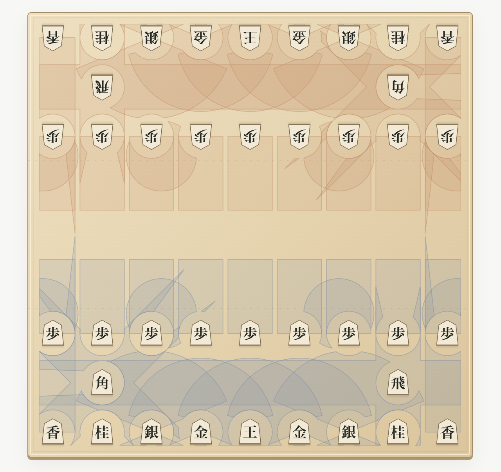

# アナログ将棋 / Analog Shogi

マス目を無くした、どこにでも置ける将棋。同じ端末で2人で遊べる無料ブラウザゲームです。



**[遊ぶ → analog-shogi.pages.dev](https://analog-shogi.pages.dev/)**

作成者：SateLLA

## 遊び方

- 自分の駒を選び、移動先をクリックするかドラッグします。
- 移動先で敵1枚に重なると取れます。味方との重なりは禁止です。
- 持ち駒を選ぶと打てる場所を表示します。配置候補には、その駒の移動後の範囲も表示します。
- 置けない場所や盤外をクリックするか、Escで選択を解除します。
- 「範囲」「危険」で両者の移動範囲や取られそうな駒の表示を切り替えられます。
- 王手を放置する手は禁止です。詰みの自動判定はなく、投了で終了します。

## 主な機能

- 移動範囲と取られそうな駒の表示
- スマホでのドラッグ操作・移動先の拡大表示
- 日本語／英語切り替え、全画面表示、盤の反転
- 最大100操作の待った、ブラウザ内への自動保存
- 棋譜の一手送り・自動再生、JSON形式の保存・読み込み

読み込んだ棋譜は再生専用で開き、対局へ戻ると元の局面を復元します。旧バージョンの対局は保存されている範囲から再生できます。

同じ端末で遊ぶ2人用ゲームです。AI、オンライン対戦、別端末との同期には対応していません。詳しい移動ルールはゲーム内の「ルール」と[仕様](docs/SPEC.md)を参照してください。

## ローカルで動かす

Node.js 20以上。外部パッケージのインストールは不要です。

```sh
npm run dev
```

`http://127.0.0.1:5173/` を開きます。

```sh
npm test         # ゲームルール・翻訳のテスト
npm run build   # 静的ファイルを dist/ に生成
npm run preview # dist/ をローカルで確認
```

devとpreviewは同じポートを使用します。別のポートで動かす場合は `PORT=5174 npm run preview` のように指定できます。

## Cloudflare Pages

| 設定 | 値 |
| --- | --- |
| Framework preset | None |
| Build command | `npm run build` |
| Build output directory | `dist` |

Direct Uploadの場合は、ビルド後の `dist/` をアップロードします。APIサーバー、データベース、環境変数は不要です。

## ソース構成

- `public/`：画面、スタイル、ゲームロジック、翻訳、検索向けメタ情報
- `scripts/`：ローカルサーバーとビルド
- `tests/`：自動テスト
- `docs/SPEC.md`：実装ルールと制限

## 図形計算

範囲表示には、同梱の[clipper-lib 6.4.2](https://github.com/junmer/clipper-lib)を使用しています。外部CDNへの接続や追加インストールは不要です。ライセンスは[public/vendor/LICENSE.txt](public/vendor/LICENSE.txt)を参照してください。
